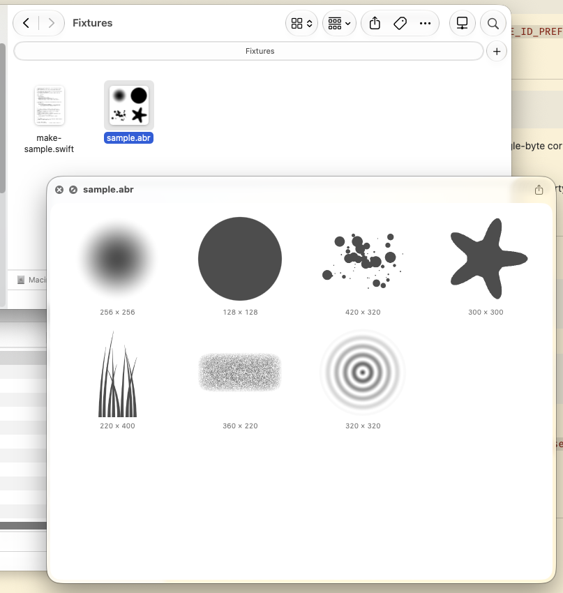

# BrushViewQL Revitalized

Quick Look previews and Finder thumbnails for Photoshop brush files (`.abr`) on macOS 14 and later.

Press Space on an `.abr` file in Finder to see every bitmap brush in a grid, with each brush's
pixel size. Finder icons show the first brush, or a 2×2 of the first four.



## Credits

This project brings back
**[BrushViewQL](https://www.littlepotatosoftware.com/products/brushviewer.html)** by Laura Dickey
of Little Potato Software. Version 1.0 came out in December 2008 and 1.1 in June 2009. It was a
`.qlgenerator` plugin for Mac OS X 10.5, and macOS 15 no longer loads that kind of plugin.

BrushViewQL Revitalized is a from-scratch rewrite as modern Quick Look app extensions. It doesn't
reuse any of the original's code, but it keeps the original's idea and its GPLv3 license.

The file format handling follows the ABR loader in **[GIMP](https://gitlab.gnome.org/GNOME/gimp)**
(`app/core/gimpbrush-load.c` and the RLE decoder in `app/core/gimp-utils.c`). That loader builds
on Marco Lamberto's abr2gbr. Thanks to the GIMP project.

## Install

There are no prebuilt downloads yet, because a downloaded app would need Developer ID signing and
notarization to get past Gatekeeper. Build it from source (see Build below), copy
`BrushViewQL Revitalized.app` to `/Applications`, and launch it once.

## What's supported

- ABR v1 and v2 (sampled brushes, raw or RLE).
- ABR v6 and v10 with subversion 1 or 2 (the `8BIMsamp` section, raw or RLE).
- 8-bit samples, and uncompressed 16-bit samples, which are converted to 8 bits.

Computed or vector brushes, other sample depths, and brushes larger than 8192 px on either side are
skipped. The preview counts how many were skipped. In v6 files, computed brushes are stored in the
`desc` section, which isn't parsed, so they aren't counted. An unknown version shows
"Unsupported ABR version N".

## Layout

| Path | What it is |
|---|---|
| `ABRKit/` | Swift package: the parser and `Brush.image(maxPixelSize:)` (renders a brush to a `CGImage`) |
| `App/` | Host app: an explanation window and a file-open view for debugging |
| `Preview/` | Quick Look preview extension (`QLPreviewingController` hosting the SwiftUI `BrushGrid`) |
| `Thumbnail/` | Thumbnail extension (`QLThumbnailProvider`) |
| `project.yml` | XcodeGen spec. The generated `.xcodeproj`, `Info.plist` and entitlements files are not checked in. |

## Build

```sh
brew install xcodegen
xcodegen generate
xcodebuild -project BrushViewQL.xcodeproj -scheme BrushViewQL -configuration Release -derivedDataPath build build
```

Signing is set to "Sign to Run Locally". To sign with your own team, set `DEVELOPMENT_TEAM` and
`CODE_SIGN_IDENTITY` at the top of `project.yml`. If you fork the project, change
`BUNDLE_ID_PREFIX` too.

## Test

```sh
cd ABRKit && swift test
```

The tests write synthetic v1, v2 and v6 fixtures (raw, RLE and 16-bit) with a small test-only ABR
writer and check that each one round-trips. They also check that every truncation and many
single-byte corruptions fail gracefully. Every `.abr` file in `Fixtures/` is parsed and checked
as well.

`Fixtures/sample.abr` is a set of seven procedural brushes in ABR v2 format, generated by
`swift Fixtures/make-sample.swift`. The script and the file are CC0. Please don't commit
third-party brush files.

## Verify

1. Copy `build/Build/Products/Release/BrushViewQL Revitalized.app` to `/Applications`, then launch it once.
   Launching it registers the extensions.
2. Check that the extensions are registered and clear the Quick Look cache:
   ```sh
   pluginkit -m -v | grep -i brush    # a leading "+" means the extension is enabled
   qlmanage -r && qlmanage -r cache
   ```
3. Show a preview and generate a thumbnail:
   ```sh
   qlmanage -p Fixtures/sample.abr
   qlmanage -x -t -s 512 -o /tmp Fixtures/sample.abr
   ```
   Without `-x`, `qlmanage -t` ignores thumbnail extensions and just hangs. `-x` sends the request
   to the system thumbnail service, which is the same path Finder uses.

If an extension isn't enabled (no `+` in the `pluginkit` output), turn it on under **System
Settings → General → Login Items & Extensions → Quick Look**, or from the command line:
`pluginkit -e use -i <bundle id>`.

Keep only one copy of the app around (for example, delete the `build/` products after installing).
Each copy that has been launched registers its own extensions.

## License

GPLv3 or later. See `COPYING`. GIMP and the original BrushViewQL use the same license.
